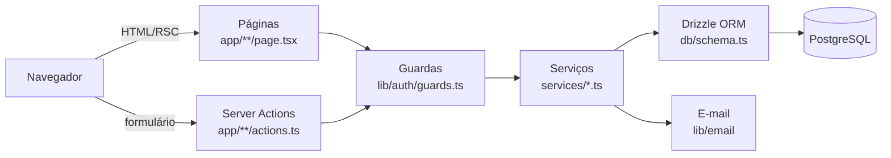

# Kombexa

> Documentação produzida na auditoria de 03/11/2026, sobre o commit `258429d` da branch `main` (versão `0.11.0` no `package.json`). Tudo aqui foi conferido no código-fonte e, quando indicado, executado de verdade. O que não pôde ser confirmado está marcado como **precisa de validação**.

## O que é

O Kombexa é um sistema web de gestão para academias de artes marciais (boxe, muay thai, jiu-jitsu, MMA etc.). Ele organiza em um só lugar o que normalmente fica espalhado entre caderno, planilha e WhatsApp: cadastro de alunos e responsáveis, mensalidades, pagamentos (inclusive parciais), caixa da academia, presença, graduações, comunicados e uma área própria para o aluno.

### Problema que resolve

Academias pequenas e médias costumam perder dinheiro e tempo com mensalidades esquecidas, pagamentos sem registro, fichas de matrícula em papel e falta de histórico. O Kombexa resolve isso com:

- mensalidades geradas automaticamente todo mês e lembretes por e-mail;
- "atrasado" calculado sempre a partir da data (nunca fica desatualizado);
- pagamentos que alimentam o financeiro sozinhos, sem contagem dupla;
- trilha de auditoria de tudo que mexe em dinheiro ou dados de alunos;
- cuidado com a LGPD: consentimento registrado, dados de saúde em área restrita, exportação e eliminação de dados do aluno.

### Público-alvo

| Perfil | Quem é | Onde entra |
| --- | --- | --- |
| `PLATFORM_ADMIN` | Quem opera a plataforma (o dono do Kombexa) | `/plataforma` |
| `ACADEMY_ADMIN` | Dono, professor ou recepção de uma academia (com permissões por pessoa) | `/` (painel) |
| `STUDENT` | Aluno adulto ou responsável por alunos menores | `/aluno` |

## Funcionalidades (verificadas no código)

Classificação usada: **Funcional** = há tela, Server Action, serviço, banco e teste automatizado; **Parcial** = funciona, mas com limitação relevante; **Não encontrada** = não existe no código.

| Funcionalidade | Situação | Onde está |
| --- | --- | --- |
| Cadastro e edição de alunos (com endereço, emergência, CPF) | Funcional | `app/(app)/alunos`, `services/students.ts` |
| Responsáveis de menores (irmãos compartilham responsável) | Funcional | `services/guardians.ts` |
| Ficha de matrícula para imprimir | Funcional | `app/(app)/alunos/[id]/ficha`, `components/EnrollmentDocument.tsx` |
| Multi-academia (isolamento por `academy_id`) | Funcional | `services/context.ts` e todos os serviços |
| Mensalidades (manual, em lote, automática) | Funcional | `services/fees.ts`, `services/automation.ts` |
| Pagamentos parciais, pendentes, confirmação e cancelamento | Funcional | `services/payments.ts` |
| Recibo com valor por extenso | Funcional | `services/receipts.ts`, `lib/extenso.ts` |
| Financeiro (entradas, saídas, saldo, CSV) | Funcional | `services/finance.ts` |
| Relatórios | Funcional | `app/(app)/relatorios`, `services/reports.ts` |
| Presença (marcar na lista) | Funcional | `services/attendance.ts` |
| Check-in por QR Code | **Parcial**: o aluno mostra o QR na carteirinha; a equipe lê com leitor USB (que "digita") ou digita o código. **Não há leitura pela câmera no navegador.** | `services/checkin.ts`, `app/(app)/presenca/CheckInForm.tsx` |
| Convite por QR Code / link / e-mail | Funcional | `services/invites.ts`, `services/enrollment.ts` |
| Equipe e permissões por pessoa (10 permissões) | Funcional | `lib/permissions.ts`, `services/users.ts` |
| Graduações (faixas/graus, histórico) | Funcional (registro feito pela academia; texto livre, sem catálogo de faixas) | `services/ranks.ts` |
| Carteirinha digital | Funcional | `app/aluno/carteirinha` |
| Documentos do aluno (ficha e recibos) | Funcional | `services/documents.ts`, `app/aluno/documentos` |
| Comunicados (mural, fixar, arquivar) | Funcional | `services/announcements.ts` |
| Área do aluno e do responsável | Funcional | `app/aluno`, `services/student-portal.ts` |
| Pix "copia e cola" (sem integração bancária) | Funcional (gera o código; **não confirma** pagamento sozinho) | `lib/pix.ts` |
| Logo da academia (validada pelo conteúdo) | Funcional (só armazenamento no banco; S3/R2 **não implementados**) | `services/branding.ts`, `lib/image.ts` |
| LGPD: exportar e eliminar dados do aluno | Funcional | `services/privacy.ts` |
| Administração da plataforma (criar/suspender academias) | Funcional | `app/plataforma`, `services/accounts.ts`, `services/users.ts` |
| Auditoria | Funcional | `services/audit.ts`, `app/(app)/auditoria` |
| Recuperação de senha e confirmação de e-mail | Funcional | `services/password-reset.ts`, `services/email-verification.ts` |
| Pagamento online / gateway | Não encontrada | — |
| App móvel nativo | Não encontrada (há manifest PWA) | `app/manifest.ts` |
| Autenticação em dois fatores | Não encontrada | — |

## Tecnologias (versões instaladas e testadas)

| Camada | Tecnologia |
| --- | --- |
| Framework | Next.js 16.4.4 (App Router, Server Components, Server Actions, Turbopack) |
| Interface | React 19.3, CSS próprio (`app/styles/`), sem biblioteca de componentes |
| Linguagem | TypeScript 6 (modo `strict`) |
| Banco | PostgreSQL 16 |
| Acesso ao banco | Drizzle ORM 0.45 + driver `postgres` (postgres.js) |
| Validação | Zod 4 |
| Senhas | bcryptjs (custo 12) |
| E-mail | Nodemailer (SMTP) ou Resend (HTTP) |
| QR Code | `qrcode` |
| Testes | Vitest 5 (com banco real) e Playwright (ponta a ponta) |
| Infra | Docker (Node 22 Alpine) e Docker Compose |
| CI | GitHub Actions (`.github/workflows/ci.yml`) |

## Arquitetura resumida



Não existe uma "API REST" separada: o backend são as **Server Actions** e algumas **Route Handlers** (`route.ts`). Detalhes em [arquitetura.md](arquitetura.md).

## Pré-requisitos

- Node.js **22** (é o que o CI e o Dockerfile usam) e npm 10.
- PostgreSQL **16** (ou Docker para subir um).
- Git.

## Instalação rápida (sem Docker)

```bash
git clone https://github.com/VictorHcss/kombexa.git
cd kombexa
npm ci
cp .env.example .env          # Windows PowerShell: Copy-Item .env.example .env
# crie os bancos fight_manager e fight_manager_test no seu PostgreSQL (ver instalacao.md)
npm run db:migrate
npm run db:seed               # dados de exemplo (senha de todas as contas: kombexa123)
npm run dev                   # http://localhost:3000
```

Passo a passo completo, com Windows e Docker: [instalacao.md](instalacao.md). Atalho de 5 minutos: `../INICIO_RAPIDO.md`.

## Scripts do `package.json`

| Comando | O que faz | Verificado na auditoria |
| --- | --- | --- |
| `npm run dev` | Servidor de desenvolvimento | sim |
| `npm run build` / `npm start` | Build e servidor de produção | sim |
| `npm run typecheck` | `tsc --noEmit` | sim (0 erros) |
| `npm run lint` | ESLint | sim (0 erros) |
| `npm test` | Vitest (usa `TEST_DATABASE_URL`, que é **apagado e recriado**) | sim (317 testes) |
| `npm run test:e2e` | Playwright (exige `npm run build` antes; usa `E2E_DATABASE_URL`, apagado e recriado) | sim (ver relatório) |
| `npm run db:migrate` | Aplica as migrations de `drizzle/` | sim |
| `npm run db:generate` | Gera migration a partir de `db/schema.ts` | não executado (não houve mudança de schema) |
| `npm run db:seed` | Dados de exemplo (idempotente; bloqueado em produção) | sim |
| `npm run db:create-admin` | Cria academia + administrador reais | sim |
| `npm run db:create-platform-admin` | Cria o administrador da plataforma | sim |
| `npm run email:test` | Testa o envio de e-mail | sim (modo console) |
| `npm run jobs:daily` | Roda a tarefa diária pelo terminal | sim |

## Estrutura de diretórios

```text
app/            páginas, layouts, Server Actions e rotas (App Router)
  (app)/        área da equipe da academia (o grupo entre parênteses não aparece na URL)
  aluno/        área do aluno/responsável
  plataforma/   área do administrador da plataforma
  api/          /api/saude e /api/tarefas/diarias
components/     componentes React reutilizáveis
db/             schema.ts (tabelas) e index.ts (conexão)
drizzle/        migrations SQL (0000 a 0011) e metadados
lib/            utilitários: auth, validação, dinheiro, datas, CSV, Pix, e-mail...
services/       regras de negócio e acesso ao banco
scripts/        migrate, seed, criação de admins, backup, tarefa diária
tests/          testes Vitest; tests/e2e: Playwright
docs/           documentação original do autor
public/         ícones do PWA e pasta da marca
```

## Informações importantes para quem for desenvolver

1. **Nunca consulte o banco numa página ou componente.** Tudo passa por `services/`, que recebe um contexto com `academyId`.
2. **Toda página e toda Server Action começa com um guarda** (`requireAcademyAdmin`, `requireStudent`, `requirePlatformAdmin`). O teste `tests/guardas.test.ts` lê o código e falha se você esquecer.
3. **Dinheiro é sempre inteiro em centavos.** Use `lib/money.ts`.
4. **"Atrasada" não é gravado no banco**: é `pending` + vencimento no passado (no fuso da academia).
5. **Mudou o schema?** Edite `db/schema.ts`, rode `npm run db:generate`, revise o SQL gerado em `drizzle/` e rode `npm run db:migrate`.
6. **Em produção, defina `APP_URL`.** Desde a auditoria, os links dos e-mails usam essa variável (ver [SEGURANCA.md](SEGURANCA.md)).

## Mapa desta documentação

| Documento | Para quê |
| --- | --- |
| [instalacao.md](instalacao.md) | Instalar e rodar, passo a passo |
| [arquitetura.md](arquitetura.md) | Como o sistema é organizado |
| [BANCO_DE_DADOS.md](BANCO_DE_DADOS.md) | Tabelas, relacionamentos e diagrama ER |
| [API_E_ROTAS.md](API_E_ROTAS.md) | Todas as rotas, páginas e Server Actions |
| [SEGURANCA.md](SEGURANCA.md) | Modelo de segurança, riscos e recomendações |
| [MANUTENCAO.md](MANUTENCAO.md) | Atualizações, backups, logs, problemas comuns |
| [AUDITORIA_TECNICA.md](AUDITORIA_TECNICA.md) | O que foi encontrado e alterado na auditoria |
| [estudos/](estudos/GUIA_DE_ESTUDOS.md) | Material didático para aprender com o próprio projeto |

A pasta `docs/` dentro do projeto é a documentação original do autor e continua válida, com duas ressalvas listadas no [AUDITORIA_TECNICA.md](AUDITORIA_TECNICA.md).
