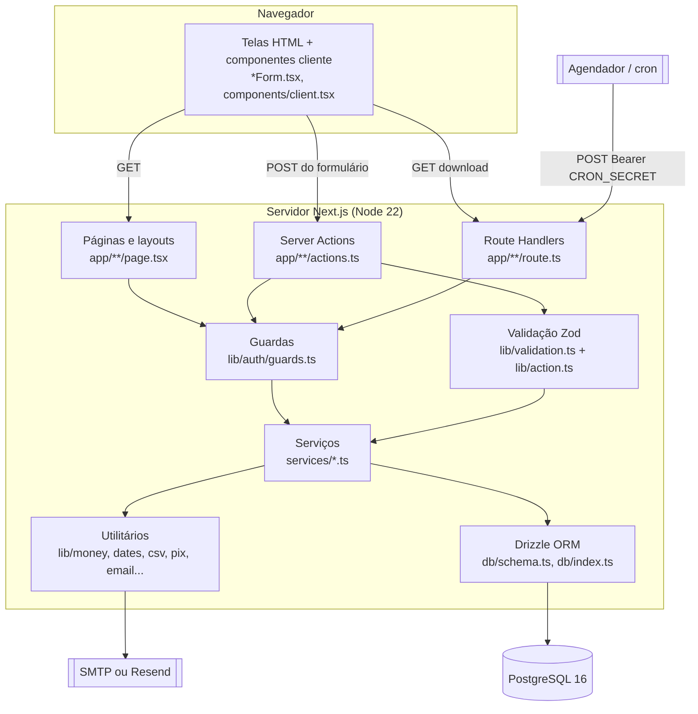
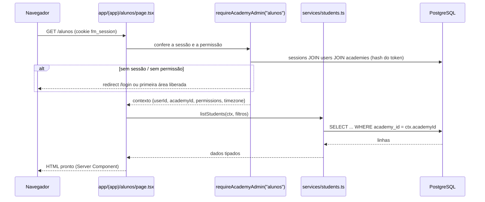
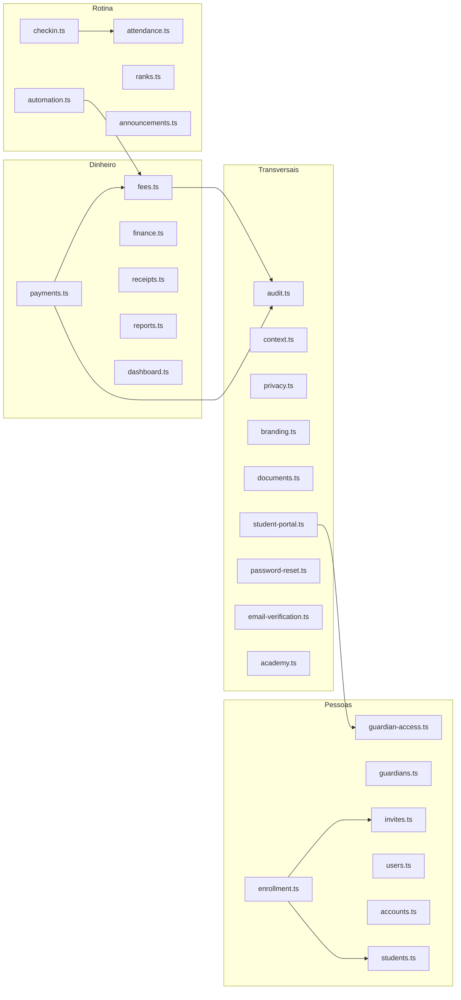
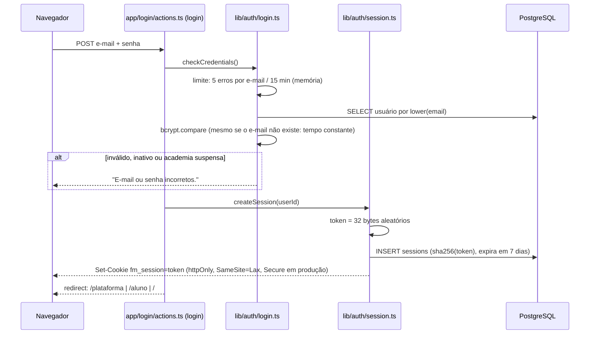
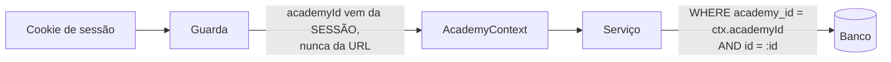
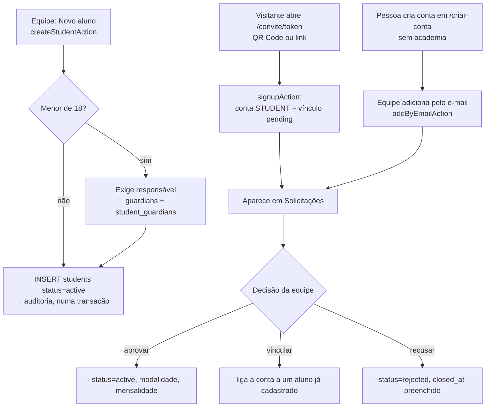
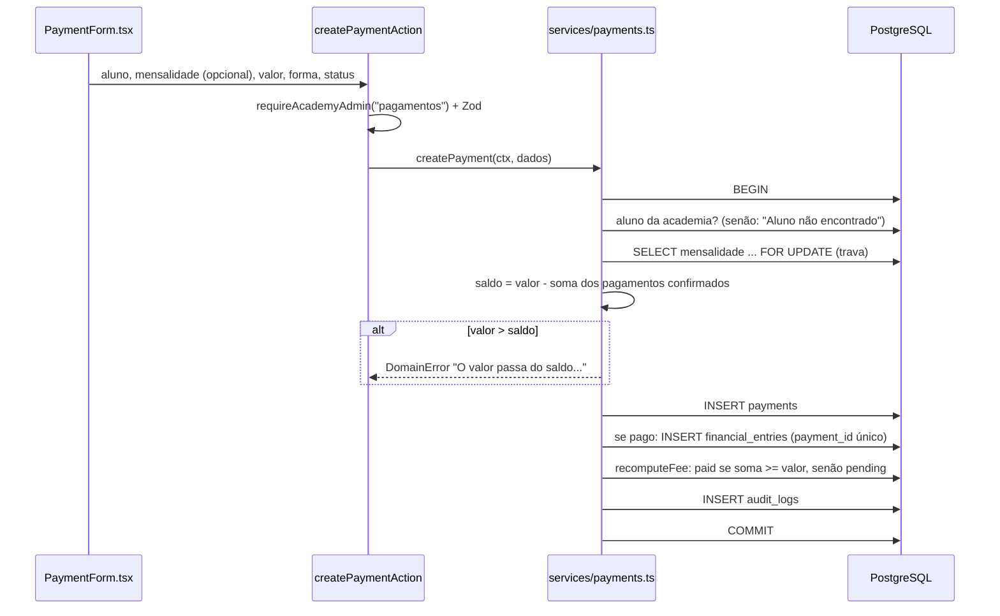
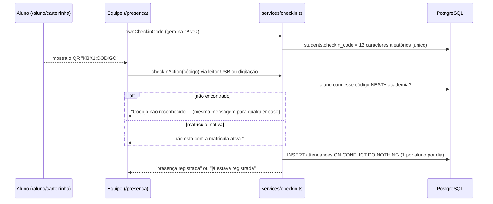

# Arquitetura do Kombexa

Todos os diagramas abaixo foram desenhados a partir do código do commit `258429d` (mais as correções da auditoria). Os nomes de arquivos e funções são reais.

## 1. Visão geral

O Kombexa é um **monólito Next.js**: frontend e backend vivem no mesmo projeto e no mesmo processo Node.js. Não existe uma API REST pública. A comunicação entre navegador e servidor acontece por três mecanismos do Next.js:

1. **Server Components** (`page.tsx`, `layout.tsx`): rodam no servidor, consultam os serviços e enviam a tela pronta.
2. **Server Actions** (`actions.ts`, marcados com `"use server"`): funções do servidor que o formulário chama diretamente. São o "backend" de todas as gravações.
3. **Route Handlers** (`route.ts`): endpoints HTTP comuns, usados só onde a resposta não é uma tela (CSV, JSON de saúde, tarefa diária, exportação LGPD).



## 2. Camadas

| Camada | Pasta | Responsabilidade | Pode acessar o banco? |
| --- | --- | --- | --- |
| Apresentação | `app/**/page.tsx`, `components/` | Desenhar telas | **Não**, só via serviços |
| Entrada | `app/**/actions.ts`, `app/**/route.ts` | Conferir acesso, validar, chamar serviço, redirecionar | **Não** |
| Acesso | `lib/auth/` | Sessão, login, guardas, senhas | Sim (sessões e usuários) |
| Regras de negócio | `services/` | Tudo que muda ou lê dados | Sim |
| Persistência | `db/` | Schema e conexão | — |
| Utilitários puros | `lib/` | Dinheiro, datas, CSV, Pix, CPF, e-mail | Não |

A regra "páginas não consultam o banco" foi verificada: nenhum arquivo em `app/` ou `components/` importa `db` diretamente para consultas de negócio (o acesso passa por `services/`).

## 3. Fluxo de uma requisição

### 3.1 Leitura (abrir uma página)



### 3.2 Gravação (enviar um formulário)

O padrão é sempre o mesmo, e vale a pena decorar:

```ts
// app/(app)/financeiro/actions.ts (padrão de todas as actions)
export async function createEntryAction(_: ActionState, form: FormData): Promise<ActionState> {
  const ctx = await requireAcademyAdmin("financeiro");          // 1. quem é e se pode
  const state = await handleForm(form, entryInput, async (data) => { // 2. valida com Zod
    await createEntry(ctx, data);                                // 3. regra de negócio
  });
  // 4. revalida a tela e redireciona com mensagem
}
```

`handleForm` (`lib/action.ts`) transforma erros em mensagens para o formulário:

- erro de validação do Zod → "Confira os campos destacados." e o erro de cada campo;
- `DomainError` (regra de negócio) → mensagem segura, mostrada ao usuário;
- qualquer outro erro → vai para o log e o usuário vê uma mensagem genérica (não vaza detalhes internos).

## 4. Organização dos serviços



| Serviço | Faz o quê |
| --- | --- |
| `context.ts` | Define `AcademyContext` e `PlatformContext` (o "crachá" de quem age) |
| `students.ts` | Cadastro, edição, status, ficha assinada, dados de saúde |
| `guardians.ts` / `guardian-access.ts` | Responsáveis e o acesso deles à área do aluno |
| `enrollment.ts` / `invites.ts` / `accounts.ts` | Convites, cadastro pelo convite, contas sem academia, aprovação |
| `fees.ts` | Mensalidades: criar, gerar em lote, editar, cancelar, recalcular situação |
| `payments.ts` | Pagamentos: criar, confirmar, cancelar (com trava de concorrência) |
| `finance.ts` / `reports.ts` / `dashboard.ts` | Caixa, relatórios e painel |
| `attendance.ts` / `checkin.ts` | Presença manual e pelo código do QR |
| `ranks.ts` | Histórico de graduações |
| `announcements.ts` | Comunicados |
| `automation.ts` | Tarefa diária (gera mensalidades e envia lembretes) |
| `privacy.ts` | Exportar e anonimizar dados (LGPD) |
| `audit.ts` | Grava a trilha de auditoria **dentro da mesma transação** |
| `academy.ts` / `users.ts` / `branding.ts` | Academia, equipe, logo |
| `student-portal.ts` / `documents.ts` / `receipts.ts` | Leitura da área do aluno |
| `password-reset.ts` / `email-verification.ts` | Recuperação de senha e confirmação de e-mail |

## 5. Autenticação

Sessão própria, guardada no banco, sem bibliotecas externas de autenticação.



Pontos importantes:

- O banco guarda **só o hash** do token. Se o banco vazar, as sessões não podem ser usadas.
- `currentUser()` recusa sessão vencida, usuário desativado e academia suspensa: suspender uma academia derruba todos na hora.
- Trocar ou redefinir a senha encerra as sessões da conta (há teste para isso).
- **Não existe `middleware.ts`/`proxy.ts`.** A proteção é feita pelos guardas em cada página e action. É uma escolha consciente do autor, garantida pelo teste `tests/guardas.test.ts`, que lê o código e falha se um arquivo da área da academia não chamar o guarda com a permissão certa.

## 6. Autorização

Três perfis (`users.role`) e, dentro da academia, permissões por pessoa (`users.permissions`, um array de texto; `null` = acesso total).

| Guarda | Usado em | Exige |
| --- | --- | --- |
| `requireAcademyAdmin()` | Painel, configurações, documentação | Ser da equipe da academia |
| `requireAcademyAdmin("alunos")` (e as outras 9) | Cada área | A permissão daquela área |
| `requireAcademyAdmin("full")` | Gerenciar a equipe | Acesso total |
| `requirePlatformAdmin()` | `/plataforma` | Perfil `PLATFORM_ADMIN` |
| `requireStudent()` | `/aluno/*` | Perfil `STUDENT` |

As 10 permissões (`lib/permissions.ts`): `alunos`, `saude`, `mensalidades`, `pagamentos`, `presenca`, `financeiro`, `solicitacoes`, `comunicados`, `configuracoes`, `auditoria`.

## 7. Multi-tenancy (várias academias no mesmo banco)

Modelo **"banco compartilhado, coluna de tenant"**: todas as tabelas de negócio têm `academy_id`.



Regras que garantem o isolamento:

1. O `academyId` vem **sempre da sessão** (`requireAcademyAdmin`), nunca de parâmetro da requisição.
2. Não existe função de serviço que busque um registro só pelo ID; toda consulta inclui `academy_id`.
3. Na área do aluno, as consultas filtram pela conta (`ownsOrGuards(ctx.userId)` em `services/guardian-access.ts`): o aluno vê o próprio vínculo e o responsável vê os dependentes.
4. Há testes de isolamento entre academias em `tests/` (por exemplo, "não altera membro de outra academia").

> Não há *Row-Level Security* do PostgreSQL: o isolamento depende da disciplina da camada de serviços. Isso é comum e funciona bem enquanto todo acesso passar por `services/`. Ver [SEGURANCA.md](SEGURANCA.md).

## 8. Fluxos de negócio

### 8.1 Cadastro de aluno

Há três portas de entrada, que terminam no mesmo tipo de registro (`students`).



Detalhes verificados: o cadastro pelo convite só aceita maiores de 18 (menores são cadastrados pela equipe, com responsável); o convite pode ter validade e limite de usos, e dois cadastros simultâneos num convite de 1 uso resultam em só um aceito (teste de concorrência).

### 8.2 Pagamento (inclusive parcial)



Consequências práticas:

- **Pagamento parcial** é natural: a mensalidade só vira `paid` quando a soma dos pagamentos atinge o valor.
- O `FOR UPDATE` impede que dois pagamentos simultâneos ultrapassem o saldo.
- Nada financeiro é apagado: pagamento e lançamento são **cancelados**, com motivo.

### 8.3 Check-in por QR Code



O QR não contém dados pessoais, e gerar um novo código invalida o anterior. **Não há leitura pela câmera no navegador**: o campo espera um leitor de QR que funcione como teclado ou a digitação do código.

### 8.4 Tarefa diária

`POST /api/tarefas/diarias` (com `Authorization: Bearer CRON_SECRET`) ou `npm run jobs:daily` chamam `runDailyJobs`. Para cada academia ativa, **no fuso dela**, a tarefa: (1) gera as mensalidades do mês que faltam, se `auto_generate_fees` estiver ligado; (2) envia o lembrete X dias antes do vencimento e o aviso no dia seguinte ao vencimento. Cada lembrete é gravado em `fee_reminders` (único por mensalidade e tipo), então rodar várias vezes não repete nada.

## 9. Integrações externas

| Integração | Obrigatória? | Como |
| --- | --- | --- |
| E-mail (SMTP ou Resend) | Não | `lib/email/index.ts`; sem configuração, imprime no console ou grava em `EMAIL_OUTBOX_DIR` |
| Webhook de erros (Discord, Slack, ntfy) | Não | `instrumentation.ts`, variável `ERROR_WEBHOOK_URL` |
| Pix | Não há integração | `lib/pix.ts` só monta o "copia e cola" a partir da chave da academia |
| Armazenamento de arquivos | Não | Logos ficam no próprio PostgreSQL (`academy_logos`) |

## 10. Decisões de projeto que valem conhecer

- **Dinheiro em centavos inteiros** (`integer`). Nunca ponto flutuante.
- **Datas de calendário como `date`** e "hoje" calculado no fuso da academia (`lib/dates.ts`).
- **Situação "atrasada" é derivada**, nunca gravada (`lib/fee-status.ts`).
- **Auditoria na mesma transação** da ação: se a ação falha, o registro de auditoria também não existe.
- **Conta (`users`) separada do vínculo (`students`)**: a mesma pessoa pode, em tese, treinar em mais de uma academia com uma só conta.
- **Cabeçalhos de segurança** em todas as respostas (`next.config.ts`): CSP, `X-Frame-Options: DENY`, HSTS em produção etc.
- **Logs de erro estruturados** em JSON (`instrumentation.ts`), fáceis de filtrar.
