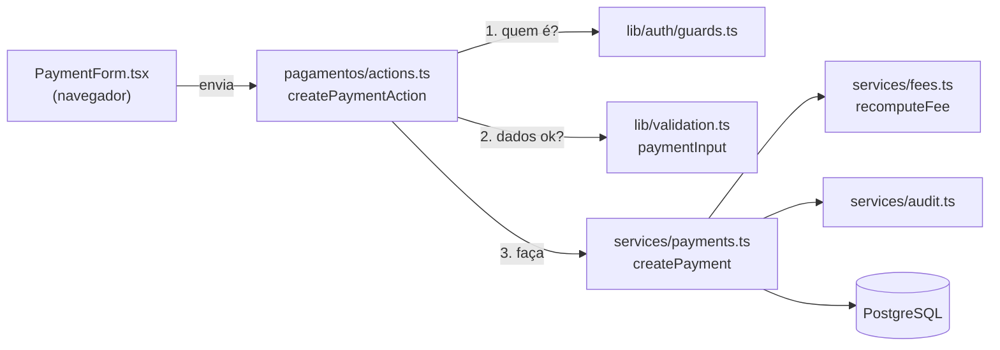

# Entendendo o projeto (em linguagem simples)

## A ideia em uma frase

O Kombexa é **um único programa** que, quando você abre uma página, consulta o banco de dados no servidor, monta a tela e a envia pronta para o navegador. Quando você preenche um formulário, o navegador envia os dados para uma função do servidor que confere, grava e devolve o resultado.

## Uma analogia: a recepção da academia

| No mundo real | No Kombexa | Pasta |
| --- | --- | --- |
| O balcão onde o aluno é atendido | As telas | `app/` e `components/` |
| A recepcionista que confere o crachá antes de abrir uma gaveta | Os guardas de acesso | `lib/auth/` |
| As regras da casa ("só aceita pagamento até o saldo") | Os serviços | `services/` |
| O arquivo de aço com as fichas | O banco PostgreSQL | `db/` e `drizzle/` |
| Calculadora, carimbo, régua | Utilitários | `lib/` |
| O livro de ocorrências | A auditoria | `services/audit.ts` |

A regra mais importante do projeto: **a tela nunca abre o arquivo de aço sozinha.** Ela sempre pede para a recepcionista (guarda), que segue as regras da casa (serviço).

## O que cada pasta faz

### `app/`: as telas e as portas de entrada

No Next.js, **a estrutura de pastas vira o endereço**. `app/alunos/novo/page.tsx` é a tela `/alunos/novo`.

| Pasta | É o quê |
| --- | --- |
| `app/(app)/` | Tudo que a **equipe da academia** vê. O nome entre parênteses é um "grupo": serve para organizar e compartilhar um layout, mas **não entra na URL**. Por isso `app/(app)/alunos/page.tsx` é `/alunos`, e não `/(app)/alunos`. |
| `app/aluno/` | A **área do aluno** (no singular!): `/aluno`, `/aluno/carteirinha`... |
| `app/plataforma/` | A área de quem administra todas as academias |
| `app/login/`, `app/esqueci-senha/`, `app/convite/`... | Telas públicas |
| `app/api/` | Dois endereços sem tela: `/api/saude` e `/api/tarefas/diarias` |
| `app/styles/` | O CSS, dividido por assunto |

Dentro de cada pasta você vai encontrar arquivos com nomes especiais:

| Arquivo | Papel |
| --- | --- |
| `page.tsx` | A tela daquele endereço |
| `layout.tsx` | A moldura em volta das telas da pasta (menu, cabeçalho) |
| `actions.ts` | Funções do servidor chamadas pelos formulários |
| `route.ts` | Um endereço que devolve um arquivo ou JSON, e não uma tela |
| `loading.tsx` | O "esqueleto" exibido enquanto a tela carrega |
| `error.tsx` / `not-found.tsx` | Telas de erro e de "não encontrado" |
| `AlgumaCoisaForm.tsx` | Formulário (componente que roda no navegador) |

### `components/`: peças de tela reutilizáveis

`ui.tsx` (cartões, títulos, avisos), `client.tsx` (botão "Salvando…", janela de confirmação), `Shell.tsx` (o menu lateral), `ReceiptSheet.tsx` (o recibo), `EnrollmentDocument.tsx` (a ficha de matrícula) etc.

### `services/`: as regras de negócio

Um arquivo por assunto: `students.ts`, `fees.ts` (mensalidades), `payments.ts`, `finance.ts`, `attendance.ts` (presença)... Toda função recebe um **contexto** (`ctx`) que diz quem está agindo e de qual academia.

### `db/`: a planta do banco

- `schema.ts`: a descrição de todas as tabelas, em TypeScript.
- `index.ts`: a conexão com o PostgreSQL.

### `drizzle/`: o histórico de obras do banco

Cada arquivo `00NN_nome.sql` é uma "reforma" aplicada em ordem. Quem roda `npm run db:migrate` num banco vazio reconstrói tudo, igualzinho.

### `lib/`: a caixa de ferramentas

| Arquivo | Ferramenta |
| --- | --- |
| `lib/auth/` | Login, sessão, senha, guardas |
| `lib/money.ts` | Converter "150,90" ⇄ 15090 centavos |
| `lib/dates.ts` | "Hoje" no fuso certo, meses, referências |
| `lib/validation.ts` | As regras de cada formulário (Zod) |
| `lib/permissions.ts` | As 10 permissões da equipe |
| `lib/csv.ts` | Gerar planilhas CSV |
| `lib/pix.ts` | Montar o código Pix "copia e cola" |
| `lib/email/` | Enviar e-mail (ou só mostrar no terminal) |
| `lib/image.ts` | Conferir se a logo é mesmo uma imagem |

### `scripts/`: comandos de terminal

Migrations, dados de exemplo, criação de administradores, backup e tarefa diária.

### `tests/`: as provas automáticas

Cada arquivo `.test.ts` testa um assunto usando um banco de verdade. `tests/e2e/` abre um navegador e clica como um usuário.

## Como os módulos se relacionam: o exemplo do pagamento

1. O aluno paga R$ 50 de uma mensalidade de R$ 150. A recepção preenche o formulário.
2. `createPaymentAction` confere a sessão e a permissão `pagamentos`.
3. O Zod confere se o valor é um número válido e o converte para `5000` centavos.
4. `createPayment` abre uma transação, **trava** a mensalidade, confere que R$ 50 não passa do saldo, grava o pagamento, cria a entrada no caixa, recalcula a mensalidade (continua "a vencer", com saldo de R$ 100) e anota na auditoria.
5. A tela volta com "Pagamento registrado".

## Onde encontrar cada funcionalidade

| Quero mexer em... | Tela | Action | Serviço |
| --- | --- | --- | --- |
| Cadastro de aluno | `app/(app)/alunos/StudentForm.tsx` | `app/(app)/alunos/actions.ts` | `services/students.ts` |
| Responsáveis | `app/(app)/alunos/ProfileForms.tsx` | idem | `services/guardians.ts` |
| Mensalidades | `app/(app)/mensalidades/` | `mensalidades/actions.ts` | `services/fees.ts` |
| Pagamentos e recibo | `app/(app)/pagamentos/` | `pagamentos/actions.ts` | `services/payments.ts`, `receipts.ts` |
| Caixa | `app/(app)/financeiro/` | `financeiro/actions.ts` | `services/finance.ts` |
| Presença e QR | `app/(app)/presenca/` | `presenca/actions.ts` | `services/attendance.ts`, `checkin.ts` |
| Convites e pedidos | `app/(app)/convidar/`, `solicitacoes/` | `actions.ts` de cada | `services/invites.ts`, `enrollment.ts` |
| Comunicados | `app/(app)/comunicados/` | `comunicados/actions.ts` | `services/announcements.ts` |
| Graduações | Perfil do aluno (`alunos/[id]/page.tsx`) | `alunos/actions.ts` | `services/ranks.ts` |
| Equipe e permissões | `app/(app)/configuracoes/` | `configuracoes/actions.ts` | `services/users.ts`, `lib/permissions.ts` |
| Área do aluno | `app/aluno/` | `aluno/*/actions.ts` | `services/student-portal.ts` |
| Carteirinha | `app/aluno/carteirinha/` | `carteirinha/actions.ts` | `services/checkin.ts` |
| Tarefa automática diária | — | `app/api/tarefas/diarias/route.ts` | `services/automation.ts` |
| Login | `app/login/` | `login/actions.ts` | `lib/auth/` |

## Três ideias que, entendidas, destravam o resto

1. **Contexto (`ctx`)**: toda função de serviço recebe "quem está agindo e de qual academia". É isso que impede uma academia de ver os dados da outra.
2. **Centavos**: dinheiro nunca é `150.9`, é `15090`. Assim não existe o famoso erro de `0,1 + 0,2 = 0,30000000000000004`.
3. **Calcular em vez de guardar**: "atrasada" não é salvo; é calculado na hora com a data de hoje. Assim nunca fica desatualizado.
