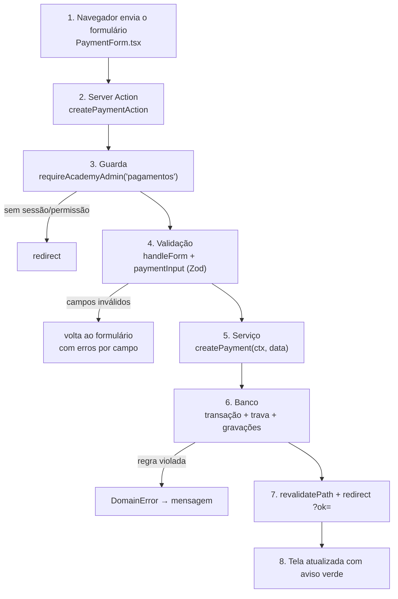

# Guia de backend: da tela ao banco e de volta

Vamos seguir **uma requisição real do começo ao fim**: a recepção registra um pagamento parcial de R$ 50,00 de uma mensalidade de R$ 150,00.



## 1. A requisição chega

O formulário (`app/(app)/pagamentos/PaymentForm.tsx`) usa `<form action={formAction}>`. O Next.js transforma o envio num `POST` com os campos em `FormData` e chama a Server Action no servidor. Para o seu código, é uma chamada de função comum:

```ts
export async function createPaymentAction(_: ActionState, form: FormData): Promise<ActionState>
```

## 2. Primeiro: quem é você?

```ts
const ctx = await requireAcademyAdmin("pagamentos");
```

O guarda (`lib/auth/guards.ts`):

1. lê o cookie `fm_session` e busca a sessão pelo **hash** do token;
2. confere se a sessão não venceu, se o usuário está ativo e se a academia não está suspensa;
3. confere o perfil (`ACADEMY_ADMIN`) e a permissão `pagamentos`;
4. devolve o **contexto**: `{ userId, academyId, permissions, timezone, user }`.

Se qualquer passo falhar, ele faz `redirect` e **nada abaixo executa**.

> Por que isso é a primeira linha? Porque Server Actions são endpoints públicos: alguém pode chamá-las sem passar pela tela. A tela esconder um botão **não é** segurança.

## 3. Os dados são válidos?

```ts
const state = await handleForm(form, paymentInput, async (data) => {
  await createPayment(ctx, data);
});
```

`handleForm` (`lib/action.ts`) faz, em ordem:

```ts
const values = formToObject(form);           // FormData → objeto de textos
const parsed = schema.safeParse(values);     // valida com Zod, sem lançar exceção
if (!parsed.success)
  return { message: "Confira os campos destacados.", errors: fieldErrors(parsed.error), values };
try {
  await run(parsed.data);                    // dados JÁ convertidos: amount = 5000 (centavos)
  return {};
} catch (error) {
  if (isRedirect(error)) throw error;        // redirect() é um "erro" especial: deixa passar
  if (error instanceof DomainError) return { message: error.message, errors: error.fieldErrors, values };
  console.error(error);                      // erro inesperado: log completo...
  return { message: "Não foi possível salvar agora. Tente de novo em instantes.", values }; // ...e mensagem genérica
}
```

Três tipos de falha, três tratamentos:

| Falha | Exemplo | O usuário vê |
| --- | --- | --- |
| Validação | "abc" no campo valor | "Valor inválido. Use o formato 150,00." embaixo do campo |
| Regra de negócio (`DomainError`) | R$ 200 numa mensalidade com saldo de R$ 150 | "O valor passa do saldo da mensalidade (R$ 150,00)." |
| Inesperada | Banco caiu | Mensagem genérica; o detalhe vai para o log, nunca para a tela |

Em todos os casos, `values` volta junto, e o formulário não perde o que foi digitado.

## 4. O serviço aplica as regras

```ts
// services/payments.ts (resumido)
export async function createPayment(ctx: AcademyContext, data: PaymentData) {
  return db.transaction(async (tx) => {                                     // (a)
    const [student] = await tx.select().from(students)
      .where(and(eq(students.id, data.studentId), eq(students.academyId, ctx.academyId)));  // (b)
    if (!student || student.status === "pending" || student.status === "rejected")
      throw new DomainError("Aluno não encontrado.", { studentId: "Aluno não encontrado." });

    if (data.feeId) {
      const fee = await lockedFee(tx, ctx, data.feeId);                     // (c)
      if (fee.studentId !== student.id) throw new DomainError("Esta mensalidade é de outro aluno.");
      const balance = fee.amountCents - (await paidCents(tx, fee.id));
      if (data.amount > balance) throw new DomainError(`O valor passa do saldo da mensalidade (${formatMoney(balance)}).`);
    }

    const [payment] = await tx.insert(payments).values({ academyId: ctx.academyId, ... }).returning();
    if (payment.status === "paid") await createIncome(tx, ctx, payment, ...);  // (d)
    if (payment.feeId) await recomputeFee(tx, payment.feeId);                  // (e)
    await audit(tx, ctx, "payment.created", "payment", payment.id, "...");     // (f)
    return payment;
  });
}
```

**(a) Transação.** Tudo dentro de `db.transaction` acontece por inteiro ou não acontece. Se a auditoria falhar, o pagamento também é desfeito. Nunca fica "meio gravado".

**(b) Filtro da academia.** Mesmo que alguém mande o ID de um aluno de outra academia, a consulta não o encontra. É assim que o multi-tenancy funciona: o `academyId` vem do contexto (sessão), não do formulário.

**(c) Trava (`SELECT ... FOR UPDATE`).** Imagine duas recepcionistas registrando R$ 100 na mesma mensalidade de R$ 150, no mesmo segundo. Sem a trava, as duas veriam saldo de R$ 150 e as duas gravariam. Com a trava, a segunda espera a primeira terminar e então vê saldo de R$ 50, recebendo o erro. Há teste automatizado para essa corrida.

**(d) Caixa.** Pagamento confirmado gera uma entrada no financeiro. A coluna `payment_id` é única no banco, então é impossível contar o mesmo pagamento duas vezes.

**(e) Recalcular, não marcar.** `recomputeFee` soma os pagamentos e decide: chegou ao valor → `paid`; senão → `pending`. Ninguém marca "pago" à mão. Por isso pagamento parcial funciona naturalmente.

**(f) Auditoria na mesma transação.** Fica registrado quem fez, quando e o quê.

## 5. Como o banco é consultado (Drizzle)

O Drizzle escreve SQL por você, com tipos:

```ts
await tx.select().from(students)
  .where(and(eq(students.id, data.studentId), eq(students.academyId, ctx.academyId)));
```

vira algo como:

```sql
SELECT * FROM students WHERE id = $1 AND academy_id = $2;
```

Os `$1`, `$2` são **parâmetros**: o valor nunca é colado no texto do SQL. É isso que torna o **SQL Injection** impossível aqui.

Quando a consulta é complexa, o projeto usa o `sql` do Drizzle, que **continua parametrizado**:

```ts
// services/dashboard.ts
sql<number>`count(*) filter (where ${fees.dueDate} < ${now})::int`
//          o ${now} vira parâmetro, não texto
```

## 6. O resultado volta

```ts
// app/(app)/pagamentos/actions.ts
revalidatePath("/", "layout");                     // tudo abaixo de "/" pode ter mudado (painel, listas)
redirect(`/alunos/${studentId}?aba=pagamentos&ok=pagamento-registrado`);  // perfil do aluno, aba de pagamentos
```

O navegador carrega a nova página (Server Component, com dados frescos), e o componente `Flash` transforma `?ok=pagamento-registrado` no aviso verde.

## 7. Tratamento de erros: as camadas de proteção

| Camada | Arquivo | O que pega |
| --- | --- | --- |
| Formulário | `lib/action.ts → handleForm` | Validação e `DomainError`, que viram mensagens |
| Página | `app/(app)/error.tsx` | Erro ao **carregar** uma tela ("Algo deu errado... Tentar de novo") |
| Servidor inteiro | `instrumentation.ts → onRequestError` | **Todo** erro do servidor vira uma linha JSON no log e, opcionalmente, um aviso no webhook |
| Banco | Índices únicos, `CHECK`, `RESTRICT` | Última barreira: mesmo com bug no código, o banco recusa dados inválidos |

E as classes de erro do projeto:

```ts
// lib/errors.ts
export class DomainError extends Error { ... }              // mensagem segura para o usuário
export class NotFoundError extends DomainError { ... }      // "Aluno não encontrado."
export function isUniqueViolation(error: unknown): boolean   // reconhece o código 23505 do PostgreSQL
```

`isUniqueViolation` é usado quando duas pessoas tentam, ao mesmo tempo, cadastrar o mesmo e-mail: o banco recusa a segunda, e `services/accounts.ts` transforma isso em "Já existe uma conta com este e-mail.", em vez de um erro técnico.

## 8. Os outros tipos de "backend" do projeto

| Tipo | Quando usar | Exemplo |
| --- | --- | --- |
| Server Action | Formulários da própria aplicação | Quase tudo |
| Route Handler (`route.ts`) | Arquivos, JSON, chamadas de máquinas | CSV, `/api/saude`, `/api/tarefas/diarias` |
| Script (`scripts/`) | Tarefas de terminal | Migrations, seed, backup |

## Checklist para criar uma funcionalidade nova no backend

1. **Schema:** a tabela precisa de colunas novas? (`db/schema.ts` → `npm run db:generate`)
2. **Validação:** crie o esquema Zod em `lib/validation.ts`.
3. **Serviço:** função em `services/` que recebe `ctx` e **filtra por `ctx.academyId`**; use transação se gravar mais de uma coisa; chame `audit()`.
4. **Action:** primeira linha = guarda com a permissão certa; depois `handleForm`.
5. **Teste:** pelo menos um de regra e um de isolamento ("não altera dados de outra academia").
6. `npm run typecheck && npm run lint && npm test`.
