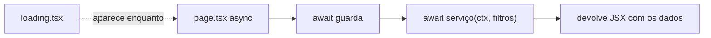

# Guia de Next.js (com o código do Kombexa)

O Kombexa usa o **Next.js 16** com o **App Router**, o modelo moderno, em que a pasta `app/` define as rotas. Todos os exemplos abaixo são trechos reais do projeto.

## 1. App Router: a pasta é o endereço

```text
app/
├── layout.tsx                 → moldura de TODAS as páginas (<html>, <body>, tema)
├── login/page.tsx             → /login
├── (app)/                     → grupo: organiza, mas NÃO aparece na URL
│   ├── layout.tsx             → moldura da área da academia (menu lateral)
│   ├── page.tsx               → /
│   ├── alunos/page.tsx        → /alunos
│   ├── alunos/novo/page.tsx   → /alunos/novo
│   └── alunos/[id]/page.tsx   → /alunos/qualquer-id   ← [id] = segmento dinâmico
├── aluno/page.tsx             → /aluno (área do aluno)
└── api/saude/route.ts         → /api/saude (sem tela)
```

Três conceitos para fixar:

- **`page.tsx`** torna a pasta acessível como página.
- **`[id]`** é um pedaço variável da URL. Em `/alunos/abc-123`, o `id` vale `abc-123`.
- **`(nome)`** é um grupo de rotas. O Kombexa usa `(app)` para dar o mesmo layout (o menu da academia) a todas as telas da equipe, sem colocar `/app` na URL.

## 2. Layouts

Um `layout.tsx` envolve todas as páginas da pasta e das subpastas. Veja o da área da academia:

```tsx
// app/(app)/layout.tsx
export const dynamic = "force-dynamic";              // (1)

export default async function AppLayout({ children }: { children: React.ReactNode }) {
  const ctx = await requireAcademyAdmin();             // (2)
  const requests = can(ctx.permissions, "solicitacoes") ? await pendingRequestsCount(ctx) : 0;
  return (
    <Shell academy={ctx.user.academyName ?? ""} user={ctx.user.name} logout={logout}
           requests={requests} permissions={ctx.permissions}>  {/* (3) */}
      <Suspense fallback={null}><Flash /></Suspense>   {/* (4) */}
      {children}                                         {/* (5) */}
    </Shell>
  );
}
```

1. `force-dynamic`: estas páginas dependem de quem está logado e do banco, então **nunca** são geradas antecipadamente no build.
2. O layout é `async` e roda no servidor: pode esperar o banco.
3. `Shell` é o menu lateral; recebe as permissões para mostrar só os itens liberados.
4. `Flash` mostra a mensagem verde de sucesso (`?ok=...`).
5. `children` é a página da vez (`/alunos`, `/pagamentos`...).

> **Cuidado (o projeto acerta isso):** o layout chama o guarda, mas **cada página chama de novo**. Layouts não re-executam em toda navegação e não protegem Server Actions. Por isso a segurança está em cada `page.tsx` e em cada action, não no layout.

## 3. Server Components (o padrão)

Todo componente dentro de `app/` é **Server Component**, a menos que o arquivo comece com `"use client"`. Server Components:

- rodam **só no servidor**: podem chamar o banco e ler segredos;
- podem ser `async`;
- **não** podem usar `useState`, `onClick` ou nada que dependa do navegador.

Exemplo real, o Início:

```tsx
// app/(app)/page.tsx
export default async function DashboardPage({ searchParams }: { searchParams: Promise<{ erro?: string }> }) {
  const ctx = await requireAcademyAdmin();
  if (!can(ctx.permissions, "mensalidades")) redirect(firstArea(ctx.permissions));
  const { erro } = await searchParams;                 // (a)
  const reference = currentReferenceIn(ctx.timezone);
  const [d, setup] = await Promise.all([              // (b)
    dashboard(ctx, reference),
    setupStatus(ctx),
  ]);
  // ... devolve o JSX já com os números
}
```

- (a) No Next 15+, `searchParams` e `params` chegam como **Promise**: é preciso `await`.
- (b) `Promise.all` faz as duas consultas **ao mesmo tempo**, e não uma depois da outra. A página abre mais rápido.

## 4. Client Components

Quando precisa de interatividade (clicar, digitar, mostrar "Salvando…"), o arquivo começa com `"use client"`:

```tsx
// components/client.tsx
"use client";
import { useFormStatus } from "react-dom";

/** Botão de envio que mostra o carregamento e evita clique duplo. */
export function Submit({ children, className = "btn btn--primary", pending: pendingText = "Salvando…" }) {
  const { pending } = useFormStatus();     // true enquanto o formulário está sendo enviado
  return (
    <button type="submit" className={className} disabled={pending} aria-busy={pending}>
      {pending ? pendingText : children}
    </button>
  );
}
```

**Estratégia do projeto:** a página (servidor) busca os dados e entrega para um pequeno componente cliente só a parte interativa. Assim, o navegador baixa pouco JavaScript.

| Server Component | Client Component |
| --- | --- |
| `app/(app)/presenca/page.tsx` (lista do dia) | `app/(app)/presenca/CheckInForm.tsx` (campo do QR) |
| `app/(app)/pagamentos/novo/page.tsx` | `app/(app)/pagamentos/PaymentForm.tsx` |

## 5. Server Actions: o "backend" dos formulários

Um arquivo que começa com `"use server"` exporta funções que **rodam no servidor**, mas podem ser passadas para um formulário como se fossem locais. O Next cuida do `POST`.

```ts
// app/(app)/presenca/actions.ts
"use server";

export async function checkInAction(_: { message?: string; ok?: string }, form: FormData) {
  const ctx = await requireAcademyAdmin("presenca");        // 1. segurança SEMPRE primeiro
  const code = normalizeCheckinCode(String(form.get("code") ?? ""));
  if (!code) return { message: "Código inválido. Ele tem 12 letras e números (ex.: ABCD-EFGH-1234)." };
  try {
    const r = await checkInByCode(ctx, code, todayIn(ctx.timezone)); // 2. serviço
    revalidatePath("/presenca");                              // 3. atualiza a tela
    return { ok: r.already ? `${r.name} já estava com presença hoje.` : `Presença de ${r.name} registrada.` };
  } catch (error) {
    if (error instanceof DomainError) return { message: error.message };
    throw error;
  }
}
```

E o lado do navegador:

```tsx
// app/(app)/presenca/CheckInForm.tsx
"use client";
export function CheckInForm() {
  const [state, action] = useActionState(checkInAction, {});  // liga o formulário à action
  return (
    <form action={action}>
      <input name="code" required />
      <Submit pending="Conferindo…">Registrar</Submit>
      {state.ok && <p className="alert alert--ok">{state.ok}</p>}
      {state.message && <p className="alert alert--danger">{state.message}</p>}
    </form>
  );
}
```

O que acontece: o usuário envia → o Next faz `POST` → `checkInAction` roda no servidor → o retorno vira o novo `state` → a mensagem aparece. Sem escrever `fetch`, sem API REST.

> **Uma Server Action é um endpoint público.** Qualquer pessoa que descubra o identificador pode chamá-la, com qualquer dado. Por isso o guarda é a primeira linha de **toda** action. A auditoria encontrou exatamente uma action sem a checagem de permissão certa (`searchStudentsAction`); ver `../SEGURANCA.md`, item 7.3.

### `revalidatePath` e `redirect`

- `revalidatePath("/presenca")` avisa ao Next que os dados daquela tela mudaram.
- `redirect("/alunos/123?ok=salvo")` leva o usuário para outra tela. Detalhe técnico que o projeto trata: `redirect` funciona **lançando um erro especial**; por isso `lib/action.ts` tem `isRedirect()`, que deixa esse "erro" passar.

## 6. Route Handlers (`route.ts`)

Para respostas que não são telas, como arquivos ou JSON:

```ts
// app/api/saude/route.ts
export const dynamic = "force-dynamic";

export async function GET() {
  try {
    await db.execute(sql`select 1`);
    return Response.json({ ok: true, at: new Date().toISOString() }, { headers: { "Cache-Control": "no-store" } });
  } catch {
    return Response.json({ ok: false }, { status: 503, headers: { "Cache-Control": "no-store" } });
  }
}
```

O nome da função (`GET`, `POST`) é o método HTTP. Outros exemplos: `app/(app)/financeiro/exportar/route.ts` (CSV) e `app/api/tarefas/diarias/route.ts` (`POST` com segredo).

## 7. Middleware

**O Kombexa não tem `middleware.ts`** (no Next 16, o arquivo passou a se chamar `proxy.ts`). A proteção é feita por **guardas chamados em cada página e action**, uma escolha deliberada: o guarda devolve o contexto tipado que os serviços exigem, e um teste (`tests/guardas.test.ts`) garante que ninguém esqueça.

Vantagem: a segurança fica junto do código que usa os dados. Desvantagem: exige disciplina, que aqui é cobrada pelo teste.

## 8. Arquivos especiais

| Arquivo | Exemplo no projeto | O que faz |
| --- | --- | --- |
| `loading.tsx` | `app/(app)/alunos/loading.tsx` devolve `<ListSkeleton />` | Mostrado na hora, enquanto a página `async` carrega (streaming) |
| `error.tsx` | `app/(app)/error.tsx` | Captura erros da página; **precisa** ser Client Component (tem botão "Tentar de novo" com `reset`) |
| `not-found.tsx` | `app/(app)/not-found.tsx` | Mostrado quando o código chama `notFound()` |
| `manifest.ts` | `app/manifest.ts` | Gera `/manifest.webmanifest` (instalar como app) |
| `icon.svg`, `apple-icon.png` | `app/` | Ícones do site |
| `instrumentation.ts` | raiz | Gancho `onRequestError`: registra todo erro do servidor em JSON |

## 9. Carregamento de dados: o padrão do projeto



- Não há `useEffect` + `fetch` para buscar dados (o jeito antigo do React). A página já nasce com os dados.
- Os filtros vêm da URL (`searchParams`). Por isso dá para copiar o link de uma lista filtrada e mandar para alguém.

## 10. Configuração: `next.config.ts`

Dois pontos para entender:

```ts
experimental: { serverActions: { bodySizeLimit: "2mb" } },   // upload da logo (até 1 MB) + o resto do formulário
async headers() { return [{ source: "/:path*", headers: securityHeaders }]; },  // CSP, anti-iframe etc.
```

## Para fixar

1. Abra `app/(app)/comunicados/` e identifique: a página (servidor), o formulário (cliente) e a action. Qual guarda cada uma usa?
2. Por que `app/(app)/error.tsx` tem `"use client"` e `loading.tsx` não precisa?
3. Exercícios 5, 9 e 12 de [EXERCICIOS_PRATICOS.md](EXERCICIOS_PRATICOS.md).
