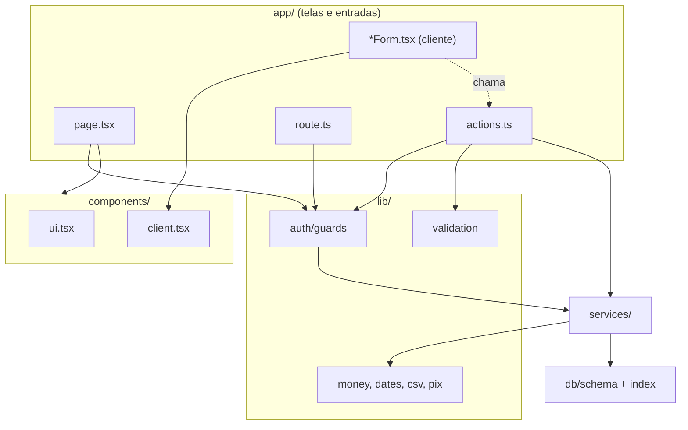

# Mapa do código

Use este mapa como um GPS: encontre a funcionalidade que quer mudar e veja **por qual arquivo começar** e **em que ordem** seguir. Todos os caminhos são relativos a `projeto/`.

## 1. Visão de cima

```text
projeto/
├── app/                      TELAS E PORTAS DE ENTRADA
│   ├── layout.tsx            raiz: <html>, tema claro/escuro, fontes
│   ├── globals.css           importa app/styles/*.css
│   ├── manifest.ts           PWA (instalar como app)
│   ├── (app)/                ÁREA DA EQUIPE (sem "/app" na URL)
│   │   ├── layout.tsx        menu lateral (Shell) + guarda
│   │   ├── page.tsx          Início (painel)
│   │   ├── alunos/           cadastro, perfil, ficha, exportação LGPD
│   │   ├── mensalidades/     lista, nova, gerar, editar, CSV
│   │   ├── pagamentos/       lista, novo, recibo
│   │   ├── financeiro/       caixa, lançamento, CSV
│   │   ├── relatorios/       relatórios (permissão financeiro)
│   │   ├── presenca/         lista do dia + check-in por código
│   │   ├── solicitacoes/     pedidos de entrada
│   │   ├── convidar/         QR Code do convite
│   │   ├── comunicados/      mural
│   │   ├── configuracoes/    academia, logo, modalidades, termos, equipe, senha
│   │   ├── auditoria/        histórico de ações
│   │   └── documentacao/     ajuda de uso
│   ├── aluno/                ÁREA DO ALUNO/RESPONSÁVEL
│   ├── plataforma/           ADMINISTRADOR DA PLATAFORMA
│   ├── login/ esqueci-senha/ redefinir-senha/ confirmar-email/ criar-conta/ convite/   PÚBLICAS
│   ├── api/saude/ api/tarefas/diarias/   ENDPOINTS SEM TELA
│   └── styles/               CSS por assunto
├── components/               peças de tela reutilizáveis
├── services/                 REGRAS DE NEGÓCIO (o coração)
├── lib/                      ferramentas (auth, dinheiro, datas, validação...)
├── db/                       schema.ts (tabelas) + index.ts (conexão)
├── drizzle/                  migrations SQL
├── scripts/                  terminal: migrate, seed, admins, backup, tarefa diária
├── tests/                    Vitest (+ tests/e2e: Playwright)
├── public/                   ícones do PWA, pasta da marca
├── docs/                     documentação original do autor
├── next.config.ts            cabeçalhos de segurança, limite de upload
├── instrumentation.ts        log de erros em JSON + webhook
├── Dockerfile, docker-compose.yml, .github/workflows/ci.yml
└── package.json              scripts e dependências
```

## 2. Os 15 arquivos mais importantes

| # | Arquivo | Por que é importante |
| --- | --- | --- |
| 1 | `db/schema.ts` | Define **todas** as tabelas e regras do banco. Comece por aqui. |
| 2 | `lib/auth/guards.ts` | Os portões de acesso: `requireAcademyAdmin`, `requireStudent`, `requirePlatformAdmin` |
| 3 | `lib/auth/session.ts` | Como a sessão é criada, lida e destruída |
| 4 | `lib/permissions.ts` | As 10 permissões da equipe |
| 5 | `services/context.ts` | O tipo `AcademyContext`: a base do isolamento entre academias |
| 6 | `lib/action.ts` | `handleForm`: o padrão de todas as Server Actions |
| 7 | `lib/validation.ts` | Todas as regras de formulário (Zod) |
| 8 | `lib/money.ts` / `lib/dates.ts` | Centavos e "hoje" no fuso certo |
| 9 | `services/fees.ts` | Mensalidades e o cálculo de situação |
| 10 | `services/payments.ts` | O serviço mais rigoroso: transação, trava, auditoria |
| 11 | `services/enrollment.ts` | Convite → cadastro → aprovação |
| 12 | `services/automation.ts` | Tarefa diária |
| 13 | `components/client.tsx` | Componentes interativos (`Submit`, `ConfirmSubmit`, `StudentSearch`, `Flash`) |
| 14 | `app/(app)/layout.tsx` | O "esqueleto" da área da equipe |
| 15 | `tests/guardas.test.ts` | A rede de segurança contra guardas esquecidos |

## 3. "Quero modificar...": por onde começar

Ordem sugerida: **schema → validação → serviço → action → tela → teste**.

### Cadastro de aluno (campos, regras)

1. `db/schema.ts` → tabela `students` (coluna nova? `npm run db:generate`)
2. `lib/validation.ts` → `studentInput`
3. `services/students.ts` → `createStudent`, `updateStudent` (e `toRow`)
4. `app/(app)/alunos/actions.ts` → `createStudentAction`, `updateStudentAction`
5. `app/(app)/alunos/StudentForm.tsx` → o campo na tela
6. `app/(app)/alunos/[id]/page.tsx` → onde o dado aparece no perfil
7. `components/EnrollmentDocument.tsx` → se deve sair na ficha impressa
8. Testes: `tests/cadastro.test.ts`, `tests/alunos-e-financeiro.test.ts`

### Responsáveis de menores

`services/guardians.ts` → `app/(app)/alunos/ProfileForms.tsx` → `services/guardian-access.ts` (acesso do responsável à área do aluno)

### Mensalidades (valor, vencimento, geração)

1. `services/fees.ts` → `createFee`, `generateMonthlyFees`, `recomputeFee`
2. `lib/fee-status.ts` → o que é "atrasada"
3. `lib/dates.ts` → `dueDateFor`, `monthRange`, `todayIn`
4. `app/(app)/mensalidades/` → telas e `actions.ts`
5. `services/automation.ts` → se a mudança afeta a geração automática

### Pagamentos e recibos

`services/payments.ts` → `services/receipts.ts` → `lib/extenso.ts` (valor por extenso) → `components/ReceiptSheet.tsx` → `app/(app)/pagamentos/`

### Financeiro e relatórios

`services/finance.ts`, `services/reports.ts`, `services/dashboard.ts` → `app/(app)/financeiro/`, `app/(app)/relatorios/` → `lib/csv.ts` (exportação)

### Presença e check-in

`services/attendance.ts` (presença manual, frequência, "sumidos") → `services/checkin.ts` (código do QR) → `app/(app)/presenca/` → `app/aluno/carteirinha/` (onde o aluno vê o QR)

### Graduações

`services/ranks.ts` → `rankInput` em `lib/validation.ts` → `addRankAction` em `app/(app)/alunos/actions.ts` → seção no perfil `app/(app)/alunos/[id]/page.tsx`

### Comunicados

`services/announcements.ts` → `app/(app)/comunicados/` (equipe) → `app/aluno/comunicados/page.tsx` (aluno)

### Equipe e permissões

`lib/permissions.ts` (lista) → `services/users.ts` (`createAcademyAdmin`, `updateUserPermissions`) → `app/(app)/configuracoes/` → `lib/auth/guards.ts` → **atualize `tests/guardas.test.ts`** se criar uma área nova

### Convites e pedidos de entrada

`services/invites.ts` → `services/enrollment.ts` → `services/accounts.ts` (conta sem academia) → `app/convite/[token]/`, `app/criar-conta/`, `app/(app)/solicitacoes/`, `app/(app)/convidar/`

### Área do aluno

`services/student-portal.ts` (tudo filtrado por `ownsOrGuards`) → `services/documents.ts`, `services/receipts.ts` → `app/aluno/`

### Login, senha e e-mail

`lib/auth/login.ts`, `lib/auth/session.ts`, `lib/auth/password.ts` → `services/password-reset.ts`, `services/email-verification.ts` → `lib/email/index.ts` → `lib/url.ts` (endereço dos links; use `APP_URL`)

### LGPD

`services/privacy.ts` (exportar e anonimizar) → `lib/consent.ts` (textos de consentimento) → `app/(app)/alunos/[id]/exportar/route.ts`, `app/aluno/meus-dados/route.ts`

### Identidade visual

`lib/image.ts` (valida PNG/JPEG/WebP pelos bytes) → `services/branding.ts` → `components/Brand.tsx`, `components/DocumentHeader.tsx` → `app/styles/kombexa.css`

### Administração da plataforma

`app/plataforma/` → `services/accounts.ts` (`createAcademyWithAdmin`, `resendAdminAccess`) → `services/users.ts` (`setAcademyActive`)

### Aparência (CSS)

`app/styles/`: `base.css` (variáveis e cores), `layout.css` (estrutura), `componentes.css` (botões, cartões), `telas.css` (telas específicas), `tema-escuro.css`, `aluno.css`, `plataforma.css`, `entrada.css` (login e cadastro), `acabamento.css`, `kombexa.css` (marca)

## 4. Mapa de dependências entre camadas



Regra de leitura: **as setas só descem**. Um serviço nunca importa uma tela; `lib/` nunca importa `services/` (exceto os guardas, que usam tipos de contexto).

## 5. Onde ficam os testes de cada assunto

| Assunto | Arquivo de teste |
| --- | --- |
| Dinheiro, datas, CSV, Pix, permissões | `lib.test.ts` |
| Alunos, mensalidades, pagamentos, financeiro | `alunos-e-financeiro.test.ts` |
| Cadastro completo, responsáveis | `cadastro.test.ts` |
| Convites | `convites.test.ts` |
| Contas sem academia | `contas.test.ts` |
| Concorrência, sessões, paginação | `concorrencia-e-seguranca.test.ts` |
| Senha, recibo, LGPD | `senha-recibo-e-lgpd.test.ts` |
| Tarefa diária e presença | `automacao-e-presenca.test.ts` |
| Equipe, suspensão de academia | `equipe.test.ts` |
| Área do aluno | `area-do-aluno.test.ts` |
| Logo, comunicados, graduações, check-in | `kombexa.test.ts` |
| Guardas (lê o código) | `guardas.test.ts` |
| Login | `login.test.ts` |
| Correções da auditoria | `auditoria-seguranca.test.ts`, `auditoria-permissoes.test.ts` |
| Navegador | `e2e/fluxos`, `e2e/permissoes`, `e2e/contas`, `e2e/senha-e-recibo`, `e2e/celular` |

Os demais arquivos (`auth`, `business`, `hardening`, `registration`, `enrollment`, `titular`, `accounts`, `money-and-dates`, `v08`, `v09`, `v10`, `v10b`, `e2e/titular`) são cópias antigas dos de cima (ver `GUIA_TESTES.md`, seção 10).
